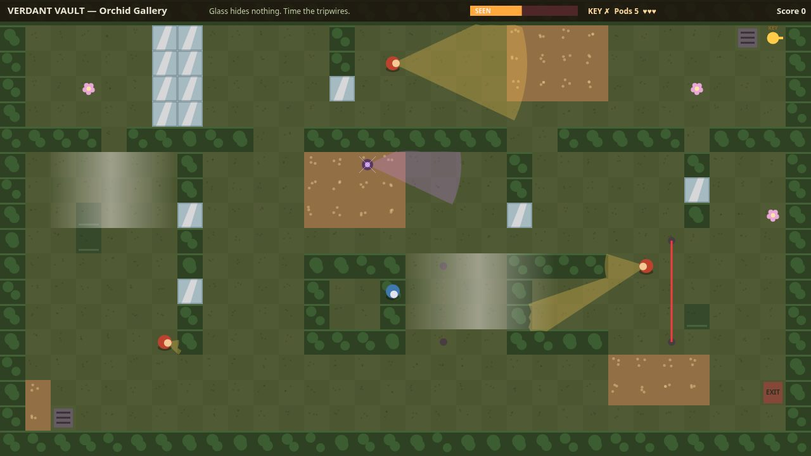

# Verdant Vault — a greenhouse stealth heist

Entered in the [make.fun](https://make.fun) bounty above. New to make.fun?
Join with the referral link https://make.fun/r/44n6pkpv

An original top-down **stealth game** for the make.fun bounty
["Make the best stealth game"](https://make.fun/bounty/best-stealth-game-20261121-1759).
You are a thief in a midnight glasshouse. On each of three floors — the
**Fern Court**, the **Orchid Gallery** and the **Moon Conservatory** —
steal the **glass key**, slip out of the **EXIT** door, and stay unseen.

## How to play

Open `game/index.html` in a desktop browser (or run `node serve.ts` and open
http://localhost:8080). It plays fully offline — no network request, no build
step, no dependencies.

- **WASD / arrow keys** — move
- **Shift** — sneak: slower, quieter, and harder to see
- **Mouse click** — throw a seed pod: wardens who hear the pop come to look
- **R** — restart the floor · **P** — pause · **M** — mute

## The stealth systems

- **Warden vision cones** patrol, pause and scan — cut short by hedges,
  exactly as drawn, so cover really is cover. **Glass panes hide
  nothing**: they block your feet, never a warden's eyes.
- **Patrol drones** sweep the galleries on fixed lanes with shorter,
  violet cones.
- **Mist banks** drift slowly across the floors. Inside one you are
  almost invisible — cross the open ground inside a bank of fog.
- **The ground talks.** Gravel crunches four tiles away and brings a
  warden to look; moss swallows your steps; sneaking halves every sound.
- **Tripwire lasers** blink on a cycle between their posts. Cross one
  while it burns and the detection meter spikes; cross it dark, free.
- **Vent grates** come in pairs: step on one and surface at the other.
- A **detection meter** fills while you are seen (faster up close,
  slower while sneaking, in mist, or on moss) and drains when you break
  sight, so a near miss is recoverable. Full meter: the wardens chase.
  Brushing a calm patrol costs meter, not a cover; an alert warden who
  reaches you costs one of three **covers** and restarts the floor.
- Wardens run four states — **patrol**, **prowl** (they investigate
  footsteps and last sightings), **chase**, and **distracted** by a
  popped seed pod — and give up a noise they cannot reach.
- Scoring rewards the key, moonpetals, unspent pods and fast clears —
  plus a **ghost bonus** for a floor nobody ever saw you on.

The levels were validated headlessly: BFS geometry confirms every key,
exit, moonpetal and vent is reachable on all three floors, the
simulation soaks stably, and a BFS autopilot playing the real
simulation clears the Fern Court unseen and reaches the Orchid
Gallery's key.

## Layout

- `main.ts` — the entrypoint: copies `game/` and `screenshots/` to the
  output directory and writes `dossier.json` with the vendored kit library.
- `game/` — the playable game as static files (`index.html` plus ES modules
  under `game/src/`, one clear job each: levels, simulation, rendering,
  input, sound, screenshot scenes).
- `screenshots/` — four real renders of the game, taken from its own
  deterministic `?shot=` scenes.
- `vendor/makefun-game.ts` — the kit's dossier library, unchanged.

## Licence

MIT — see `LICENSE`.
